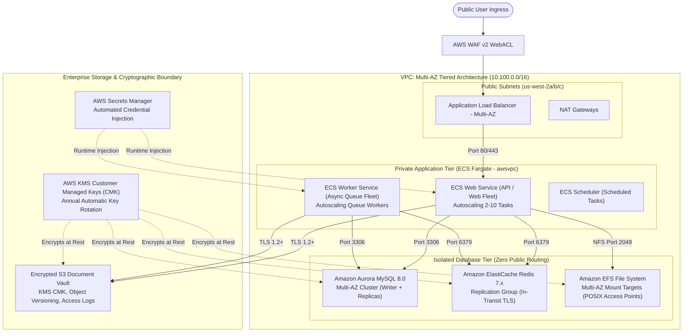
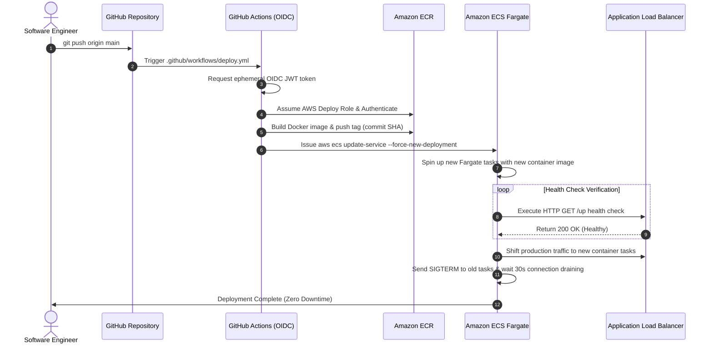

# Enterprise SaaS Cloud Platform: System Design Document (SDD)

> **Platform Architecture:** Modular AWS SaaS Infrastructure Blueprint  
> **Source Repository:** [`terraform-aws-production-saas-blueprint`](https://github.com/paulkanz/terraform-aws-production-saas-blueprint)  
> **Compliance & Governance:** NIST SP 800-53 Rev 5, SOC 2 Type II, CIS AWS Foundations Benchmark v3.0, HITRUST CSF  
> **Maintainer:** Paul Kanz (Staff Platform & Infrastructure Architect)  

---

## 1. Executive Summary & Architectural Vision

This System Design Document specifies the architecture of an enterprise **multi-tier SaaS platform** on Amazon Web Services (AWS), authored entirely in modular Terraform (HCL).

The architecture is engineered to execute a mission-critical **cloud modernization**: transitioning stateful, legacy compute workloads into a **serverless, auto-scaling, highly resilient, and compliance-hardened cloud ecosystem**.

---

## 2. Core Architectural Pillars

### 2.1 MicroVM Compute Isolation (Serverless ECS Fargate)
* **Zero Host OS Management:** Workloads execute within isolated, single-tenant AWS Firecracker microVMs managed by AWS Fargate. Eliminates underlying Linux kernel vulnerability patching, host-level configuration drift, and SSH/bastion attack vectors.
* **Elastic Autoscaling:** Dynamic target tracking autoscaling policies reacting to real-time CPU utilization (`75%` target) and Memory utilization (`80%` target), scaling from a 2-task baseline up to a 10-task peak.
* **Separation of Compute Concerns:** Decoupled into distinct ECS task definitions and services:
  * **Web/API Fleet:** Stateless HTTP request handlers behind the Application Load Balancer.
  * **Worker Fleet:** Dedicated background queue workers pulling jobs from Redis/SQS.
  * **Scheduled Tasks:** Automated cron and batch maintenance execution via AWS EventBridge and ECS `RunTask`.

### 2.2 Strict 3-Tier Network Micro-Segmentation
* **Tier 1 — Public Subnets:** Houses only the Application Load Balancers and managed NAT Gateways. Direct internet ingress is strictly permitted on Ports 80 (redirect) and 443 (HTTPS).
* **Tier 2 — Private Application Subnets:** Houses the ECS Fargate container instances. Instances obtain egress to the internet exclusively via NAT Gateways; zero public IPs are assigned (`assign_public_ip = false`).
* **Tier 3 — Isolated Database Subnets:** Dedicated subnets hosting Amazon Aurora MySQL and ElastiCache Redis clusters. These subnets have **zero route table entries to the Internet or NAT Gateways**, rendering direct inbound and outbound internet access topologically impossible.

### 2.3 Defense-in-Depth Cryptographic Security
* **Customer Managed Keys (KMS CMK):** All data at rest across Aurora MySQL, ElastiCache Redis, Amazon EFS, S3 buckets, and CloudWatch log groups is encrypted using dedicated Customer Managed Keys with automatic annual rotation enabled.
* **Zero Plaintext Secrets on Disk:** Database master passwords, application secrets, and Redis authentication tokens are stored in AWS Secrets Manager and injected dynamically into container memory during task bootstrapping via native ECS `secrets` definitions.
* **Perimeter Defense (AWS WAF v2):** Web Application Firewall inspecting all inbound HTTP(S) requests at the ALB tier, enforcing the AWS Managed Common Rule Set (OWASP Top 10), Known Bad Inputs, Amazon IP Reputation Lists, and volumetric rate limiting (2,000 req / 5-min window).

---

## 3. Detailed Subsystem Specifications (The 10 Modules)

| Module | Technical Scope & Resource Responsibilities | Regulatory / Control Alignment |
| :--- | :--- | :--- |
| **`modules/vpc`** | Provisions a Multi-AZ VPC across 3 Availability Zones with dedicated Public, Application, and Isolated Database subnets. Deploys NAT Gateways, Internet Gateways, Elastic IPs, Route Tables, VPC Flow Logs to CloudWatch, and S3 Gateway VPC Endpoints. | **NIST AC-4, AU-12; CIS 3.9, 5.1** |
| **`modules/ecs`** | Manages ECS Fargate Cluster, Task Definitions for Web, Worker, and Scheduled cron tasks, Application Load Balancer (ALB), Target Groups with HTTP `/up` health checks, and Target Tracking Auto Scaling. | **NIST SC-7, CP-10; CIS 5.4** |
| **`modules/database`** | Deploys an Amazon Aurora MySQL 8.0 Multi-AZ cluster with 1 primary writer and read replicas. Configures automated 30-day backups, Performance Insights, enhanced monitoring (60s granularity), and KMS encryption. | **NIST CP-9, SC-13; CIS 2.3.1** |
| **`modules/redis`** | Deploys an Amazon ElastiCache Redis 7.x Replication Group with Multi-AZ automatic failover, transit encryption (TLS), at-rest encryption (KMS CMK), and Redis AUTH token authentication. | **NIST SC-8, IA-5** |
| **`modules/efs`** | Configures an Elastic File System for shared persistent container assets across AZs. Enforces KMS CMK encryption at rest, POSIX file permissions via EFS Access Points, and automated lifecycle management. | **NIST CP-9, SC-13** |
| **`modules/s3`** | Establishes the Document & Asset Vault with S3 Public Access Block (all 4 flags), bucket versioning, mandatory TLS 1.2+ bucket policies, KMS CMK encryption, server access logging, and Glacier transition rules. | **NIST SC-8, AU-9; CIS 2.1.1 - 2.1.4** |
| **`modules/kms`** | Creates centralized Customer Managed Keys (CMKs) with least-privilege key policies allowing scoped access to RDS, S3, Secrets Manager, and CloudWatch Logs. Enforces automatic 365-day key rotation. | **NIST SC-12, SC-13; CIS 2.8** |
| **`modules/security`** | Provisions AWS WAFv2 WebACL, chained Security Groups enforcing east-west ingress boundaries, IAM Task Execution Roles, IAM Application Task Roles, and keyless GitHub Actions OIDC deploy roles. | **NIST AC-2, AC-3, SC-7** |
| **`modules/route53`** | Manages Private Hosted Zones (`.internal`) providing internal service discovery CNAME records for Aurora primary writer, Aurora read-only replicas, Redis cache, and internal load balancers. | **NIST SC-7** |
| **`modules/migration`** | Automates one-off database migration runs via decoupled ECS `RunTask` tasks, and provisions CloudWatch metric alarms for replication lag during database migration cutovers. | **NIST CM-3, SI-2** |

---

## 4. High-Availability, Fault Tolerance & Disaster Recovery

### 4.1 Multi-AZ Redundancy Across All Tiers
* **Web/API Tier:** Minimum of 2 Fargate tasks distributed evenly across distinct Availability Zones (`us-west-2a`, `us-west-2b`, `us-west-2c`). If an AZ suffers a complete outage, AWS ALB immediately shifts traffic to healthy tasks in remaining AZs without human intervention.
* **Database Tier:** Aurora MySQL clusters maintain 6 copies of data replicated across 3 AZs at the storage layer. In the event of primary database instance failure, Aurora automatically promotes a read replica to primary in under 30 seconds.
* **Cache Tier:** ElastiCache Redis replication group runs Multi-AZ with automatic failover enabled (`automatic_failover_enabled = true`).

### 4.2 Recovery Point & Recovery Time Objectives (RPO / RTO)
* **RPO (Recovery Point Objective):** $< 5 \text{ minutes}$. Aurora continuous incremental backups allow point-in-time recovery (PITR) to any second within the 30-day retention window. S3 Document Vault enforces versioning and cross-tier lifecycle archiving.
* **RTO (Recovery Time Objective):** $< 15 \text{ minutes}$. Entire platform infrastructure is codified in Terraform. In a catastrophic regional disaster scenario, the full multi-tier infrastructure can be stood up in an alternate AWS region (`us-east-1` or `us-east-2`) via `terraform apply`.

---

## 5. Developer Experience & Continuous Delivery ("Golden Paths")

1. **Keyless AWS Authentication:** CI/CD uses GitHub Actions OpenID Connect (OIDC) federation, eliminating long-lived static AWS access keys and secret keys from GitHub repository settings.
2. **Zero-Downtime Rolling Updates:** ECS Fargate performs canary/rolling updates:
   * New container tasks spin up and bind to target groups.
   * ALB polls `/up` health check endpoints.
   * Traffic shifts seamlessly once targets pass consecutive health checks.
   * Old tasks receive `SIGTERM`, allowing 30 seconds to drain active database transactions before termination.
3. **Database Migration Safety:** One-off database schema migrations execute via isolated ECS `RunTask` containers prior to web traffic cutover, verified by automated replication lag alarms.

---

## 6. Regulatory & Security Compliance Cross-Reference

| Framework | Control Code | Implementation Details in Codebase |
| :--- | :--- | :--- |
| **NIST SP 800-53 Rev 5** | **AC-2 / AC-3** | Separate IAM execution and task roles; least-privilege policies; zero default SG rules. |
| | **AC-4** | 3-tier VPC network isolation; database subnets completely disconnected from internet. |
| | **AU-2 / AU-12** | VPC Flow Logs to CloudWatch Logs; ECS Container Insights; 90-day retention. |
| | **CP-9 / CP-10** | Aurora 30-day automated PITR backup; Multi-AZ cross-zone replication; S3 versioning. |
| | **SC-7** | AWS WAFv2 perimeter filtering (OWASP Top 10, rate limiting, bad bot IP reputation). |
| | **SC-8** | Mandatory TLS 1.2+ on ALB and S3 buckets; Redis in-transit encryption. |
| | **SC-12 / SC-13** | Dedicated KMS CMK with automated annual rotation; Secrets Manager encryption. |
| **CIS AWS Benchmark v3.0** | **2.1.1 - 2.1.4** | S3 public access block (all 4 flags), KMS encryption, versioning, access logging. |
| | **2.3.1** | Aurora MySQL storage encrypted with Customer Managed Key (CMK). |
| | **2.4.1** | ALB enforces modern TLS 1.2+ policy (`ELBSecurityPolicy-TLS13-1-2-2021-06`). |
| | **2.8** | Annual rotation enabled on all KMS Customer Managed Keys. |
| | **3.9** | VPC Flow Logging enabled with CloudWatch log destination. |
| | **5.1** | Default security group closes all inbound and outbound traffic. |
| | **5.4** | ALB configured with `drop_invalid_header_fields = true`. |
| **SOC 2 Type II** | **CC6.1 / CC6.6** | East-west traffic authorized strictly by security group ID; perimeter WAF inspection. |
| | **CC6.7** | End-to-end data encryption in transit across all public and internal network hops. |
| | **CC7.1** | Centralized CloudWatch monitoring, structured JSON logging, and APM tracing hooks. |
